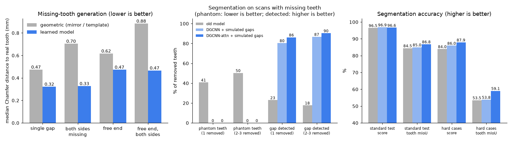
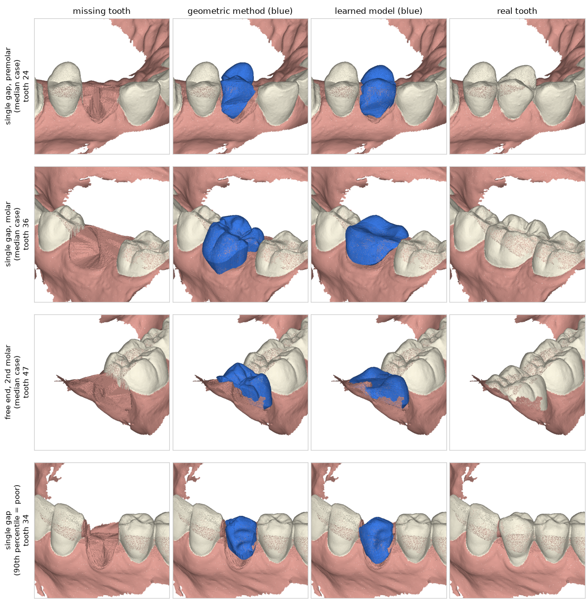

# dental_3d_ai
**口腔 3D 扫描模型（上下颌 STL）输入 → 牙齿实例分割 → 识别缺牙位置 → 自动生成缺失牙齿 3D 模型**

## 效果一览

仓库自带三个训练好的模型，详细的图文说明见 **[docs/results.md](docs/results.md)**。

| 模型 | 结论（都在模型没见过的测试数据上） |
|---|---|
| 牙齿分割 | 常规口扫综合分 96.6%；模拟缺牙检出 92–93%，在医生确认的 286 颗真实缺牙上检出 55%（放宽到相邻牙位 72%；牙齐全的口扫上有 3.4% 误报缺牙） |
| 缺失牙生成 | 与真牙的距离 0.30–0.47 mm，比原来的几何方法（0.47–0.88 mm）小 1/3 到 1/2；表面细节偏平滑 |
| 预备体颈缘线 | 误差中位数 0.04–0.05 mm（前牙到磨牙的代型）；只在单独的代型上验证过，还没接入流程 |

下面两张图是 2026-11-12 画的，图里标的数字是接着训练之前的，以上表和 docs/results.md 的表格为准。



缺牙 → 生成的牙（蓝色）→ 真牙。每行一个病例，前三行是误差中位数的病例，第四行是较差的病例：



## 文档

| 文档 | 内容 |
|---|---|
| [docs/index.html](docs/index.html) | **效果报告页**（图为主）：每次训练有提升后更新；仓库打开 GitHub Pages（main 分支 `/docs`）后就是项目主页 |
| [docs/results.md](docs/results.md) | **模型效果一览**：分割、缺失牙生成、颈缘线的效果图、指标和已知问题 |
| [docs/resources.md](docs/resources.md) | **外部资料清单**：牙冠生成、点云补全、咬合等方向的论文、代码、数据集，以及每一项能不能用上 |
| [docs/system-architecture.md](docs/system-architecture.md) | 系统架构：前端、后端、算法服务、3D 渲染与交互、部署 |
| [docs/algorithm-architecture.md](docs/algorithm-architecture.md) | 算法架构：模型分工、数据收集标注训练全链路 |
| [docs/architecture.md](docs/architecture.md) | 各任务的技术调研、论文和开源方案对比 |
| [docs/product-analysis.md](docs/product-analysis.md) | 竞品解析（dentalai.ai / 3Shape / 先临三维）与功能规划 |
| [docs/industry-landscape.md](docs/industry-landscape.md) | 产业界、学术界格局与 AI 提效数据 |
| [docs/datasets.md](docs/datasets.md) | 公开数据集清单（Teeth3DS、Poseidon3D 等）、许可、手动下载 → 上传 GCS → 云端取用的步骤 |
| [docs/real-data-test.md](docs/real-data-test.md) | 真实口扫测试记录：发现并修复的问题、缺失牙生成与真牙的对比 |
| [docs/annotation-guidelines.md](docs/annotation-guidelines.md) | 标注规范 v1.0：牙齿分割与编号（含数据接收要求、病例登记表模板、质量控制） |
| [docs/evaluation.md](docs/evaluation.md) | 分割评估（Teeth3DS、官方指标）与朝向归一化 |
| [docs/research-log.md](docs/research-log.md) | 全部调研记录汇总（时间线、资料总表、待核对、改正记录） |

## 目录

```
ml/        核心算法包 dental_ai（与 Web 无关，可单独使用）
  dental_ai/fdi.py              FDI 牙位编号工具
  dental_ai/segmentation/       分割接口、远程分割服务客户端、CPU 分割基线（梯度提升树）、编号纠错、后处理
  dental_ai/detection/          缺牙检测
  dental_ai/generation/         缺失牙生成（对侧镜像 / 标准牙模板 + 缺隙拟合；learned.py：学习式，模板变形网络）、预备体牙冠生成
  dental_ai/templates/          标准牙模板库（牙齿局部坐标系、内置参数化模板、从标注数据构建）
  dental_ai/margin/             牙颈线提取、预备体颈缘线检测（几何方法；learned.py：学习式）、贴合牙龈的底面生成
  dental_ai/preferences.py      设计参数（邻接距离、咬合距离、粘接间隙等）
  dental_ai/orientation.py      朝向归一化（分割前把任意朝向的口扫转到标准坐标系）
  dental_ai/evaluation.py       分割评估（挑战赛官方指标、TGNet 口径、论文口径）、朝向评估
  dental_ai/eval_generation.py  缺失牙生成评估（在真实口扫上模拟缺牙，与真牙比较）
  dental_ai/keypoints.py        牙齿关键点（3DTeethLand 标注）解析和统计
  dental_ai/datasets.py         从 Teeth3DS / Poseidon3D 压缩包按划分导出、直接读取
  dental_ai/pipeline.py         端到端流程 / 命令行入口
  dental_ai/synthetic.py        合成牙弓，用于测试和联调
backend/   FastAPI 服务
services/  算法服务（每个模型一个容器）
  tgnet/                        TGNet 分割服务（需要 NVIDIA GPU）
models/    模型权重（不提交到 git，见 models/README.md）
frontend/  React + Three.js 查看器和标注编辑器（src/editor）
scripts/   工具脚本（合成数据、公开数据集下载）
data/      下载的数据集（不提交到 git）
docs/      设计文档
```

## 用 Docker 启动

前端 + 后端（没有 GPU 时，上传标签文件跳过分割）：

```bash
docker compose up --build
```

加上 TGNet 分割服务（需要 NVIDIA GPU 和 nvidia-container-toolkit，权重放法见 [models/README.md](models/README.md)）：

```bash
docker compose --profile gpu up --build
```

浏览器打开 http://localhost:8080 。

首页左下的“示例病例”里点一个就能跑（缺牙生成、预备体牙冠、自动分割等 6 个，数据在仓库 `demo/` 目录，不用自己准备文件），
处理完在“病例”列表里点开看三维结果。

自带示例都是单颌的（Teeth3DS 的上下颌不在咬合位）。手里有咬合对齐的上下颌口扫（Bite2Text）时，可以生成**上下颌成对**的本地示例（不提交，数据许可不允许放进公开仓库）：`python scripts/make_bite_demos.py --zip <Bite2Text.zip> --labels data/bite_labels`。
结果页里生成的牙是青色并带“生成 <牙号>”标签；示例可以勾选“叠加原始牙”和被去掉的真牙对比，有对颌时半透明显示对颌。

连不上 Docker Hub（拉 python / node / nginx / redis 镜像超时）时用镜像站：

```bash
DOCKER_REGISTRY=docker.m.daocloud.io docker compose up --build
```

服务跑在另一台机器上时，在自己电脑上做端口转发再打开 http://localhost:8080 ：`ssh -N -L 8080:localhost:8080 <用户>@<服务器>`。

## 本地开发

需要 Python ≥ 3.10、Node ≥ 18。

```bash
pip install -e "ml[dev]" -r backend/requirements.txt
```

生成合成数据（下颌缺 36）：

```bash
python scripts/make_synthetic.py --jaw lower --missing 36 --out samples
```

命令行跑完整流程：

```bash
cd ml && python -m dental_ai.pipeline ../samples/synthetic_lower.obj --jaw lower --labels ../samples/synthetic_lower.json --out ../out
```

启动后端：

```bash
cd backend && uvicorn app.main:app --reload --port 8000
```

启动前端（另开一个终端，浏览器打开 http://localhost:5173，上传 `samples/` 下的 .obj 和 .json）：

```bash
cd frontend && npm install && npm run dev
```

下载公开数据集（Teeth3DS 许可 CC BY-NC-ND 4.0，仅限非商业研究；数据放在 `data/`，不进 git）：

```bash
python scripts/download_datasets.py teeth3ds-sample
```

用这个真实口扫生成缺牙演示数据（默认去掉 46），在网页上同时上传 `samples/demo_lower.obj` 和 `samples/demo_lower.json`，颌位选下颌：

```bash
python scripts/make_demo.py --missing 46 --out samples
```

加 `--prepared 46` 把 46 模拟磨成肩台预备体（上传时“预备体牙号”填 46）。

`teeth3ds-sample` 是官方仓库里的 1 个真实下颌口扫（约 12 MB），用来冒烟测试；`teeth3ds-splits` 是官方划分文件；`teeth3ds` 是完整数据集（OSF，几十 GB）；`fetch --name <名字> --src gs://...` 从自己的 GCS 私有桶取（步骤见 docs/datasets.md）。

运行测试（下载了示例病例时会多跑真实数据的回归测试，否则跳过）：

```bash
cd ml && pytest -q
```

```bash
cd backend && pytest -q
```

前端单元测试（标注编辑逻辑）：

```bash
cd frontend && npm test
```

不用 Docker 直接启动（用仓库自带的模型，GPU 服务器上常用）：`bash scripts/serve.sh`。

GPU 服务器上训练分割、生成、颈缘线模型的一键脚本，以及换服务器后怎么接着训练，见 scripts/gpu/README.md。

TGNet 服务的接口测试（用假模型，不需要 GPU）：

```bash
pytest -q services/tgnet/tests
```

## 数据集、训练和评估

数据集清单、许可和下载方法见 [docs/datasets.md](docs/datasets.md)。密钥（`GOOGLE_API_KEY` 等）放在仓库根目录的 `.env`（模板 `.env.example`，不会提交）或云端环境的环境变量里。

```bash
python scripts/download_datasets.py fetch --name drive --src gdrive://<Drive 文件夹 ID> --no-extract
```

按划分导出（全部解压要 40 GB）：

```bash
cd ml && python -m dental_ai.datasets teeth3ds --zips ../data/drive/raw/Teeth3DS --split <划分文件> --out ../data/teeth3ds_test
```

缺失牙生成评估、模板库、关键点、CPU 分割基线：

```bash
cd ml && python -m dental_ai.eval_generation --data-dir ../data/teeth3ds_test --out ../eval_generation
```

```bash
cd ml && python -m dental_ai.templates build --zips ../data/drive/raw/Teeth3DS --split <训练集划分> --out ../models/templates --workers 4
```

```bash
cd ml && python -m dental_ai.keypoints --zips ../data/drive/raw/Teeth3DS --out ../eval_keypoints
```

```bash
cd ml && python -m dental_ai.segmentation.baseline train --zips ../data/drive/raw/Teeth3DS --split <training_lower.txt> <training_upper.txt> --scans 300 --out ../models/segmentation/baseline.joblib
```

用 Teeth3DS（CC BY-NC-ND）构建的模板、训练出的模型只能用于研究，`.gitignore` 已排除，不要提交或分发。结果见 [docs/real-data-test.md](docs/real-data-test.md)。

## 标注编辑器

处理完成后，右侧就是编辑器：

| 模式 | 快捷键 | 操作 |
|---|---|---|
| 查看 | V | 左键旋转、右键平移、滚轮缩放 |
| 改牙号 | S | 在牙位图上选牙号，再点击模型上的一颗牙（或一块牙龈），整块改成该牙号 |
| 画笔 | B | 选牙号，按住左键涂抹，修正牙齿和牙龈的边界；可以调画笔半径 |
| 拆牙 | X | 两颗牙连成一块时：在牙位图选新牙号，在这块牙上点两下画一条切线，较小的一边改成新牙号 |
| 测量 | D | 在模型上点两下显示两点距离（mm） |
| 调整生成牙 | T | 点击蓝色的生成牙，拖动手柄移动 / 旋转 / 缩放（W / E / R 切换），点“保存调整”；每次都从原始生成结果变换，重新计算后清空 |
| 颈缘线 | M | 在牙位图上选牙，“设为预备体”后自动检测颈缘线；拖动青色控制点移动，Shift+点击模型添加控制点（没有颈缘线时可以逐点画），Alt+点击控制点删除；点“保存颈缘线” |

撤销 Ctrl+Z，重做 Ctrl+Shift+Z。结果面板里可以下载单颗牙的 STL，或“下载全部（合并成一个 STL）”。改完点“保存并重新计算”：修正后的标签保存为新版本，并重新运行缺牙检测、生成和封底。模型的原始预测会单独保留，用作训练数据。

## 当前状态

- 分割：TGNet 已做成独立的 GPU 服务（`services/tgnet`），后端通过 `SEGMENTER_URL` 调用；没有 GPU 时用 CPU 基线（`BASELINE_MODEL`，Teeth3DS 测试集挑战赛综合分 94.8%，牙齿边界较粗，见 docs/real-data-test.md 3.6.2）；上传标签文件时直接使用标签。调用前会先做朝向归一化，分割后自动做编号纠错（纠错可用 `NUMBERING_FIX=0` 关闭）；
- 真实口扫：已在 Teeth3DS 的 1 个示例病例上跑通完整流程，修复了 11 个只在真实数据上出现的问题（孤立顶点、扫描小洞、牙颈线夹点、封底非流形、两颗牙连成一块等），见 docs/real-data-test.md。完整数据集在 OSF，本开发环境访问不了，待在能访问的机器上下载后重跑；
- 带标签的数据请用 OBJ/PLY。STL 没有共享顶点，读入时会合并顶点，顶点顺序与标签文件对不上；
- 生成：外形供体优先用对侧同名牙镜像，对侧也缺（或是预备体）时用标准牙模板库；支持两侧都有邻牙的缺隙、牙弓末端（游离端，如最后一颗磨牙）和连续多颗缺牙。放置位置：沿牙弓方向按缺隙和各牙标准宽度分配，颊舌方向用对侧镜像位置或局部牙弓曲线；游离端优先用对侧同名牙的镜像位置，对侧也没有时沿牙弓局部外推。真实口扫上（模拟缺牙后与真牙比较）：对侧镜像的表面偏差 0.3–0.65 mm，内置模板约 1 mm；
- 深度分割模型（`segmentation/deep.py`，仓库自带 `models/segmentation/deep.pt`，没有 TGNet 服务时后端默认用它）：DGCNN + 全局自注意力，训练数据里加了模拟缺牙，所以缺牙的口扫上不会再把缺牙区认成牙；公平测试集综合分 96.6%，缺牙检出 86–90%（对比见 scripts/gpu/README.md）。已知问题：缺牙后邻牙编号偶尔错位；
- 学习式生成（`generation/learned.py`，可选）：从完整牙弓里挖掉一颗牙，网络看其余牙齿的点云和牙位，把开口的穹顶模板变形成这颗牙冠（边界环对齐牙颈线）。`python -m dental_ai.pipeline ... --gen-model models/generation/toothgen_open.pt` 或后端环境变量 `GEN_MODEL` 启用，不设置时仍是对侧镜像 / 模板；第三磨牙、现存牙太少时自动退回几何方法。公平测试集上四种缺牙场景的 Chamfer 中位数都低于几何方法（见 scripts/gpu/README.md）。限制：没用对颌信息（有对颌时只做整体下沉）；用 Teeth3DS 训练，权重只能用于研究；
- 学习式颈缘线（`margin/learned.py`，**没有接入流程**）：点云网络预测每个顶点到颈缘线的有符号距离，取零等值线，不需要初始线。在单独的代型上训练和测试过（52 个切牙代型 + 78 个各牙位代型）（没有牙龈和邻牙），整颌口扫上没有验证；
- 标准牙模板库：默认用内置的参数化模板（按教科书平均尺寸程序生成的**简化形态**，只是占位）。有标注数据后用 `python -m dental_ai.templates build --data-dir <obj> --gt-dir <标注> --out models/templates` 构建真实模板，后端通过 `TEMPLATE_DIR` 读取（docker-compose 已挂载 `models/templates`）。注意 Teeth3DS 是 CC BY-NC-ND 4.0，用它构建的模板不能直接商用；
- 底面：缺失牙场景（底面贴合牙龈）已实现；先把牙冠底边切成光滑的扇贝形再封底，真实口扫上导出的 STL 封闭且是流形；
- 预备体颈缘线：自动检测（几何方法，合成肩台预备体上平均误差约 0.13 mm）+ 编辑器人工编辑；上传时填写预备体牙号，或在编辑器里设置；
- 预备体牙冠：沿颈缘线精确切开预备体，组织面贴合（粘接间隙、颈缘处渐变为 0、去倒凹），外表面用对侧同名牙镜像，邻接距离按设计参数调整，保证最小冠厚度，颈缘处缝合成封闭 STL（`result/crown_<牙号>.stl`）。缺失牙同样做邻接调整。限制见 docs/algorithm-architecture.md 的 E2 一节。
