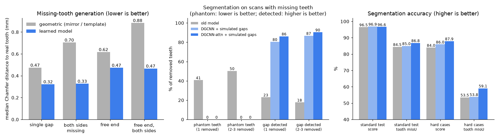
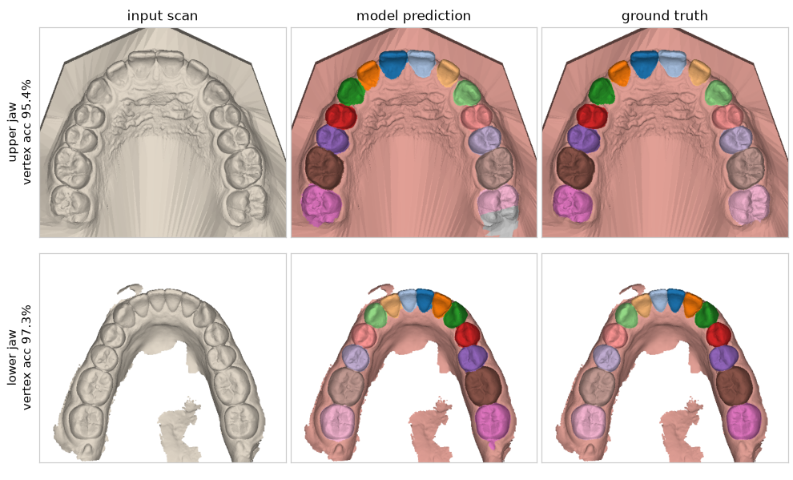
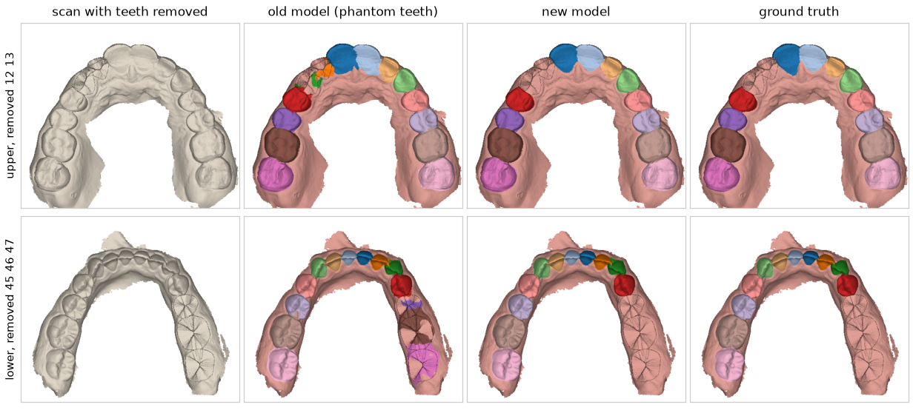
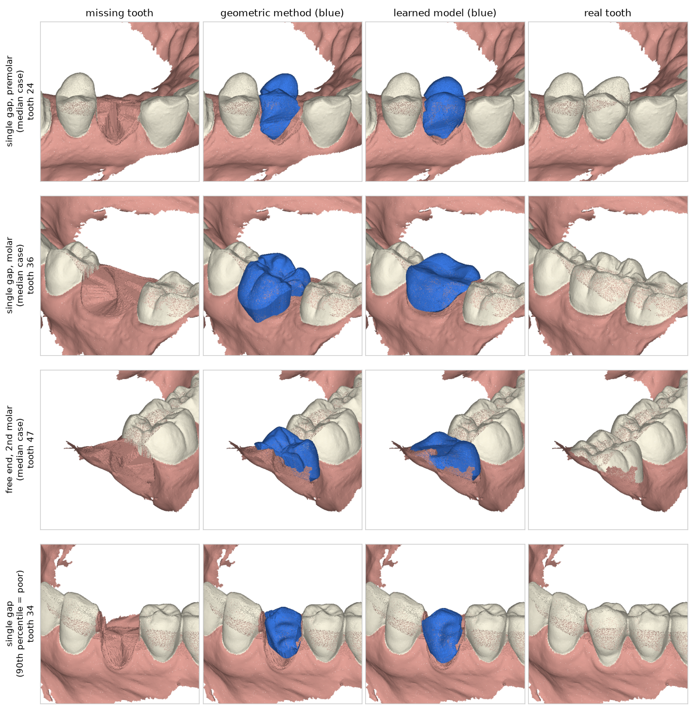
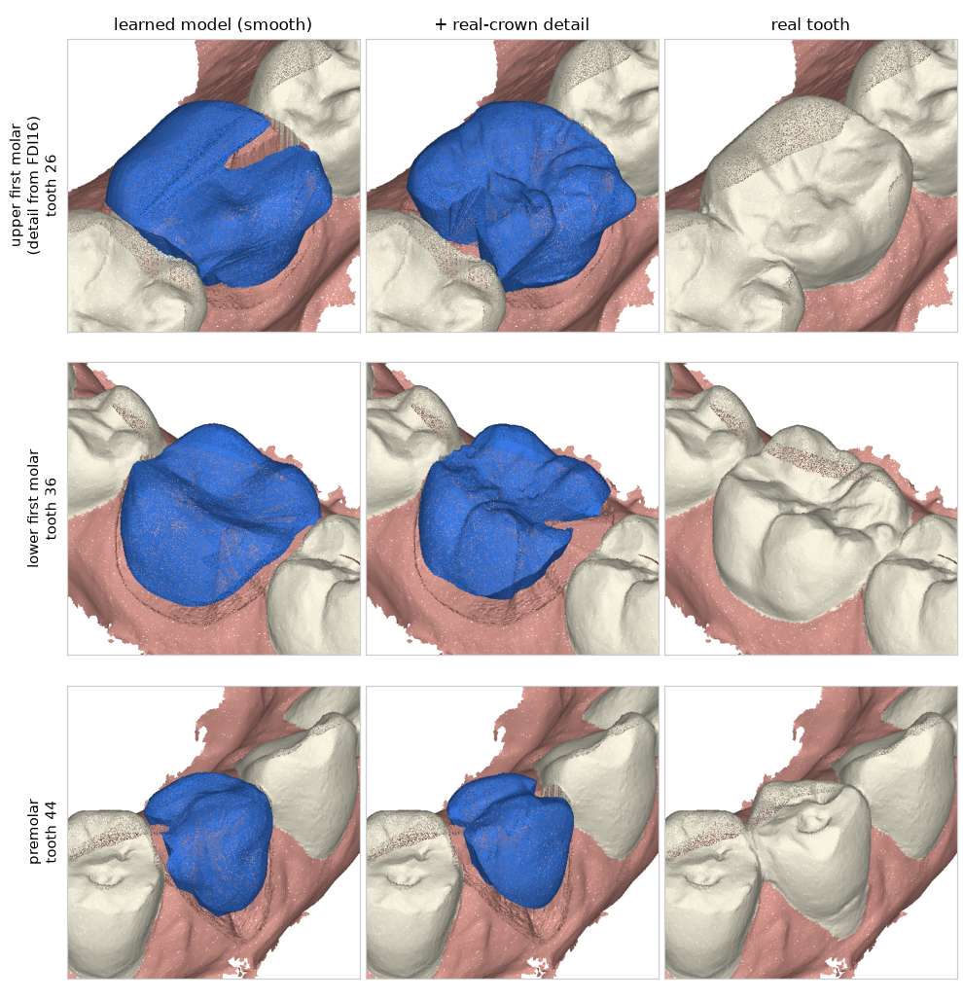
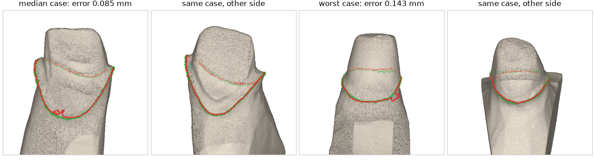

# 模型效果一览

仓库自带三个训练好的模型（`models/` 下），这页用图和数字说明它们各自做得怎么样、哪里还不行。
所有数字都来自**模型没见过的测试数据**；图里的病例不是挑好看的，选法写在每张图下面。
更新日期：2026-11-13（表格里的数字）。模型先在 RTX 3090 上训练，11-13 在 RTX 4090 上接着训练了一晚，颈缘线模型加入了新数据。
**图是 11-12 画的，没有重画**：图里标的数字和分割、颈缘线的画面对应接着训练之前的模型，以表格为准。

| 模型 | 作用 | 一句话结论 | 接入流程 |
|---|---|---|---|
| 分割 `segmentation/deep.pt` | 口扫 → 每颗牙的范围和牙号 | 常规口扫综合分 96.5%；模拟缺牙检出九成，**真实缺牙只检出四成** | ✅ 后端默认 |
| 缺失牙生成 `generation/toothgen_open.pt` | 缺牙位置 → 一颗新牙冠 | 比原来的几何方法更接近真牙（误差约小 1/3 到 1/2），但表面细节偏平滑 | ✅ 可选（`GEN_MODEL`） |
| 颈缘线 `margin/margin.pt` | 预备体 → 颈缘线 | 误差中位数 0.04–0.05 mm，前牙到磨牙的代型都测过，但都是单独的代型 | ❌ 还没接入 |

*左：生成的牙与真牙的距离，越低越好。中：缺牙口扫上的分割，“幻影牙”越低越好、“缺牙检出”越高越好。右：分割准确率，越高越好。*

---

## 1. 牙齿分割

输入一个口扫网格，输出每个顶点属于哪颗牙（FDI 牙号）或牙龈。

*左：输入的口扫。中：模型预测。右：人工标注。每种颜色是一个牙号。病例是测试集按名字排序的前两个（上、下颌各一个）。*
*上颌这例左下角最后一颗磨牙有一块被标成了灰色（误认成第三磨牙），这类局部错误是目前的典型问题。*

| 测试集 | 综合分 | 牙齿 mIoU | 所有牙号全对的扫描 |
|---|---|---|---|
| 常规口扫（174 个） | 96.5% | 87.3% | 84% |
| 真实困难病例（Poseidon3D，20 个：拥挤、缺牙） | 87.3% | 60.1% | 40% |

*接着训练前（11-12）是 96.6% / 86.8% / 85% 和 87.9% / 59.1% / 45%：这两组数字基本持平，有升有降，都在波动范围内；接着训练的收益在下面的缺牙检测上。*

### 缺牙的口扫

最初的模型只见过完整牙列，遇到缺牙的口扫会把缺牙的地方也标成牙（“幻影牙”），后面的流程就发现不了缺牙。
在训练数据里加入模拟缺牙的样本、并换成能看到整个牙弓的网络结构后，这个问题解决了：

*第一列：去掉几颗牙之后的口扫。第二列：旧模型，缺牙处仍有颜色（幻影牙）。第三列：新模型。第四列：正确答案。*
*病例选法：旧模型出错、新模型全对的病例里按名字排序的前两个，用来说明修复的是什么问题；整体比例见下表。*

| | 旧模型 | 新模型 |
|---|---|---|
| 幻影牙（缺 1 颗 / 缺 2–3 颗） | 41% / 50% | **0% / 0%** |
| 缺牙被检出（缺 1 颗 / 缺 2–3 颗） | 23% / 18% | **91% / 94%** |
| 缺牙检测完全正确的扫描（不多报不漏报） | 20% / 3% | **79% / 78%** |

*新模型一列是 11-13 接着训练后的结果；接着训练前是 86% / 90% 和 72% / 71%。*

### 真实缺牙（Bite2Text，2026-11-13）：只检出四成

上面的缺牙指标都来自模拟缺牙。Bite2Text 数据集（约 1000 位患者的口扫 + 医生写的咬合报告）里，医生会写明哪些牙缺失影响了咬合评估，从英文报告里抽出这些牙号，得到 153 位患者、286 颗**医生确认缺失的恒牙**（另有 15 颗是恒牙没萌出、乳牙还在位，单独统计），用它们测现在的分割 + 缺牙检测：

| | 模拟缺牙（上表） | 真实缺牙（286 颗） |
|---|---|---|
| 缺牙被检出（牙号完全正确） | 91% / 94% | **41%** |
| 检出，或报成了相邻牙位 | — | 49% |
| 缺牙处仍被标成那颗牙 | 0% | 59% |

| 牙位 | 颗数 | 检出 | 说明 |
|---|---|---|---|
| 尖牙 | 37 | 62% | 最好 |
| 第一磨牙 | 76 | 54% | 放宽到相邻牙位是 64% |
| 第二磨牙 | 29 | 52% | |
| 前磨牙，左右对称缺失（正畸拔牙的典型情况） | 81 | 26% | 缺隙已经闭合 |
| 前磨牙，其他 | 31 | 42% | |
| 侧切牙 | 32 | 12% | 多为先天缺失，间隙被尖牙占据 |

失败的主要原因：**真实缺牙和模拟缺牙不是一回事**。模拟缺牙是把一颗牙压平、留下一个空隙；真实病例里很多缺隙已经闭合（正畸拔牙后关闭间隙、先天缺牙后邻牙移过来），牙是挨着的。模型学到的是“一个颌有 14 颗牙”，于是按顺序连续编号，甚至把一颗牙分成两个牙号来凑数：189 个颌里有 100 个分出的牙数超过了实际可能的数量（多 1 颗 67 个，多 2 颗 31 个）。

其他观察：
- 带全局注意力的模型（现在的 `deep.pt`）41%，原结构（`deep_dgcnn.pt`）33%；被两份以上报告同时提到的缺牙（70 颗）检出 59%；
- 对照组（报告完全没提缺牙的 79 个颌）里有 20 个被报了缺牙，37 颗里 35 颗是第二磨牙（儿童病例第二磨牙没萌出，或没扫到），其他牙位的误报很少；
- 15 颗“恒牙没萌出、乳牙还在位”的全部没检出：模型把乳牙当成了对应的恒牙。

这个测试的局限：真值来自文字报告的规则抽取（抽查 14 位患者的抽取结果都正确，没有逐条核对）；报告只在缺牙影响咬合评估时才提，所以算不了误报率；缺隙闭合的前磨牙缺的是第一还是第二前磨牙，医生靠的是病史，单看口扫本来就难以区分，“牙号完全正确”对这类偏严；“分出的牙数超过实际可能”假设报告列全了该象限的缺牙，混合牙列里的乳牙会让这个数字偏高。
复现：`python -m dental_ai.eval_real_missing extract / run`（见文件开头的说明），数据要自己注册下载。

**还不行的地方**
- **真实缺牙只检出四成**（见上）：缺隙闭合的情况基本检测不到，需要在训练数据里模拟“缺牙且间隙闭合”的牙列；
- 缺牙后邻牙的编号偶尔错位（比如去掉 46 后把 47 标成 46），所以“完全正确”不到八成；
- 缺牙是模拟出来的（把牙压平到牙龈高度），和真实的缺牙区不完全一样。真实困难病例上有提升（综合分 84.0% → 87.3%），但只有 20 个病例；
- 拥挤、错位严重的牙列仍然明显差于常规口扫。

---

## 2. 缺失牙生成

缺牙检测找到缺牙位置后，生成一颗新的牙冠。仓库里有两种方法：
- **几何方法**（原有）：把对侧同名牙镜像过来；对侧也缺时用标准牙模板；
- **学习模型**（新）：网络看其余牙齿的形状和位置，直接生成这颗牙。

*每行一个病例。第一列：缺牙。第二、三列：两种方法生成的牙（蓝色）。第四列：被去掉的真牙。*
*病例选法：前三行是各场景里学习模型误差最接近**中位数**的病例（代表一般水平）；第四行是第 90 百分位的病例（代表较差的情况，这一例学习模型不如几何方法）。*

在 174 个测试扫描上模拟缺牙，跑完整流程（生成、邻接调整、封底），再和真牙比较（Chamfer 距离中位数，越小越好）：

| 场景 | 牙数 | 几何方法 | 学习模型 | 学习模型更好的比例 |
|---|---|---|---|---|
| 单颗缺失（对侧同名牙在） | 167 | 0.47 mm | **0.30 mm** | 77% |
| 左右同名牙都缺 | 284 | 0.70 mm | **0.32 mm** | 98% |
| 游离端（最后一颗磨牙） | 138 | 0.62 mm | **0.47 mm** | 70% |
| 两侧游离端 | 242 | 0.88 mm | **0.46 mm** | 94% |

*11-13 接着训练 160 轮后的结果；之前是 0.32 / 0.33 / 0.47 / 0.47 mm。数据没变，多训练带来的提升很小（约 0.01 mm），游离端没有变化。*

两种方法生成的实体都是封闭的，可以直接导出 STL。

### 真牙细节库（实验性，默认关闭）

针对“表面偏平滑”试的一个办法（2026-11-13）：学习模型给出位置、大小和大体外形，再从一个真牙冠库里找最像的一颗贴合上去，让低频形状跟着预测走、牙尖窝沟来自真牙。库里是 Teeth3DS 训练集每个牙位 150 颗牙冠，加上 FDI 16 数据集的 591 颗上颌第一磨牙（只用于 16 / 26）。

*左：学习模型的输出。中：换上真牙细节之后。右：真牙。三行都是该类里学习模型误差最接近中位数的病例；第一行的细节来自 FDI 16。*

| 场景 | 学习模型 | + 真牙细节库 |
|---|---|---|
| 单颗缺失 | **0.30 mm** | 0.33 mm |
| 左右同名牙都缺 | **0.32 mm** | 0.34 mm |
| 游离端 / 两侧游离端 | 0.47 / 0.46 mm | 不变（第二磨牙不换） |
| 只看 16 / 26（156 颗） | **0.304 mm** | 0.315 mm（只用 Teeth3DS 的牙冠）/ 0.316 mm（加上 FDI 16） |

结论，照实说：
- **和真牙的距离没有变小，反而略大**（约 0.02 mm）。换上去的是“别人的牙尖”，位置不会正好对上真牙的牙尖，按距离算不如平均形态；
- 外观上牙尖和窝沟更明显（图中第二行最清楚），但不是每个病例都更好（第三行的前磨牙显得偏小）；
- **FDI 16 相比 Teeth3DS 自己的牙冠没有带来可测的差别**（0.316 对 0.315 mm）。156 颗 16 / 26 里有 63 颗最后选中了 FDI 16 的牙冠；
- 第二磨牙不能换：Teeth3DS 里最后一颗磨牙常常扫描不全，换上去误差明显变大（游离端 0.47 → 0.56 mm，还有几例生成失败），所以代码里跳过了；
- 因此这个功能默认关闭。要试的话先建库（`python -m dental_ai.generation.detail build …`，约 5 分钟，490 MB，见 scripts/gpu/README.md），再设置环境变量 `GEN_LIBRARY`。
  库是数据集的衍生数据，不随仓库分发。

要真正解决“偏平滑”，需要换成能生成细节的模型（扩散模型、几何图像表示、对颌条件），见 [resources.md](resources.md) 里对 CrownFusion、VBCD 的记录。

**还不行的地方**
- **表面细节偏平滑**：从图上能看出，学习模型的位置和大小更准，但牙尖、窝沟不如镜像过来的真牙清晰（镜像方法用的是一颗真实的牙，细节天然完整）。距离指标更好不等于外形更好看；
- 没有用对颌牙的信息（有对颌时只做整体下沉，不调整咬合面形态）；
- 不生成第三磨牙；
- “左右同名牙都缺”“两侧游离端”两行的对照是内置的简化模板，不是用真实数据构建的模板库，对照偏弱；
- 评估用的是模拟缺牙，真实缺牙病例上没有“真牙”可比，无法这样评估。

---

## 3. 预备体颈缘线

输入一个磨好的预备体，输出颈缘线（牙冠边缘要贴合的那条线）。

*绿色：技工确认的颈缘线。红色：模型预测。左两幅是误差中位数的病例（正反两面），右两幅是 11 个测试病例里最差的一个。*

11-13 加入了第二个公开数据集（78 个代型，前牙、前磨牙、磨牙都有），按患者划出 15 个做测试，其余 63 个和原来的 41 个切牙代型一起训练：

| 测试集 | 只用切牙训练的旧模型 | 加入新数据后（现在的 `margin.pt`） |
|---|---|---|
| 切牙代型 11 个：平均误差的中位数 / 最差的一个 | 0.085 mm / 0.14 mm | **0.053 mm** / 0.14 mm |
| 切牙代型：误差在 0.2 mm 以内的点 | 95.5% | **100%** |
| 各牙位代型 15 个：平均误差的中位数 / 最差的一个 | 0.085 mm / 2.17 mm | **0.038 mm** / 0.46 mm |
| 各牙位代型：误差在 0.2 mm 以内的点 | 91% | **98%** |

旧模型在没见过的牙位上有 5 个代型平均误差超过 0.4 mm（最差 2.17 mm）；新模型 15 个里有 13 个在 0.2 mm 以内，剩下两个是 0.36 mm（16 号牙）和 0.46 mm（11 号牙）。
几何方法（需要分割给出的初始线）在切牙测试集上约 0.13 mm；学习模型不需要初始线。

**还不行的地方**
- **没有接入流程**。训练和测试数据都是单独的代型（共 130 个，没有牙龈和邻牙），直接用到整颌口扫上的效果没有验证过；
- 测试集很小（11 + 15 个），后牙只有 11 个测试代型，个别病例误差仍有 0.4 mm 左右；
- 新数据集的许可是“仅限研究和教育用途”，所以这个模型也不能商用；
- 预测线局部偶尔有小的打结（图中左下能看到），需要后处理平滑。

---

## 怎么复现

| 内容 | 命令 |
|---|---|
| 启动服务，自己上传口扫看效果 | `bash scripts/serve.sh` |
| 重新训练 / 接着训练 | `scripts/gpu/README.md` |
| 重新生成这页的图 | `python scripts/make_result_figures.py` |

数据来源：Teeth3DS（CC BY-NC-ND 4.0，仅限非商业研究）、Poseidon3D（CC BY 4.0）、teethPreparationData（MIT）、intellident-ai/public-datasets（仅限研究和教育用途）。
图中的口扫来自 Teeth3DS 测试集。用 Teeth3DS 训练的模型只能用于研究，商用需要用自有授权数据重新训练。
